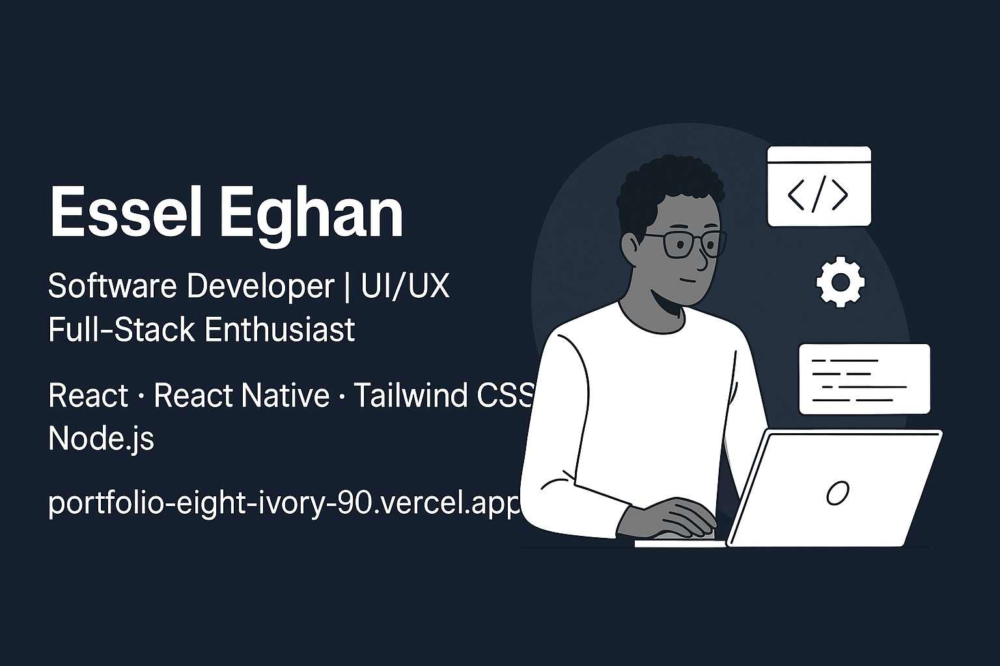

<!-- ===================== HEADER ===================== -->

  

<h1 align="center">Hi there, I'm Essel Eghan! </h1>

  

  
  
  
  

---

## 💻 About Me

I'm **Essel Eghan**, a software developer and UI/UX designer with an IT background from the **University of Ghana** 🎓.

I build sleek, scalable and reliable **web, mobile and 3D experiences** — with an eye for design and the user behind the screen.

- 🔭 Currently building **full-stack web & mobile products**
- 🌱 Exploring **3D on the web** and game development
- 👯 Open to **collaborations, freelance & full-time roles**
- 💬 Ask me about **React, React Native, Node.js & UI/UX**
- ⚡ Fun fact: I balance coding with fitness 💪

 

---

## 🧰 Tech Stack

  <b>Languages</b> 
  

  <b>Frontend & Mobile</b> 
  

  <b>Backend & Database</b> 
  

  <b>Design, Games & Tools</b> 
  

<i>🧰 Also skilled in PC diagnosis & troubleshooting.</i>

---

## 🚀 Featured Projects

| Project | Description | Stack |
|---------|-------------|-------|
| 🏡 **Multi-Vendor Real Estate App** | A scalable property management system for agents, landlords and buyers. | React · Node.js · Tailwind |
| 🩺 **Health Care Management System** | Find healthcare providers and book appointments with ease. | React · Tailwind · MongoDB |
| 🧳 **Sojourn Cabins Dashboard** | Guest management dashboard for bookings and service coordination. | React · Tailwind |
| 🛒 **E-Commerce Platform** | Fast, responsive storefront to browse, buy and manage products. | React · Tailwind |
| 🎮 **First-Person Shooter Game** | Immersive FPS with dynamic environments and addictive gameplay loops. | Unity · C# |
| 🚭 **Quit Smoking App** | Mobile-first habit tracker with logging and chatbot support. | React Native · Firebase |

---

## 📊 GitHub Analytics

  
  

  

  
<b>🏆 GitHub Trophies</b>

   
  

    
  

---

## 🐍 Contribution Snake

  <picture>
    <source media="(prefers-color-scheme: dark)" srcset="https://raw.githubusercontent.com/hydi-official/hydi-official/output/github-snake-dark.svg">
    <source media="(prefers-color-scheme: light)" srcset="https://raw.githubusercontent.com/hydi-official/hydi-official/output/github-snake.svg">
    
  </picture>

---

## 🖼️ Hero Illustration

  

---

## 🔥 Fun Facts

- 🎮 I create games too! (Unity + C# fanboy.)
- 🧠 Debugging is my form of digital detective work.
- 🎨 I design it in Figma, then build it for real.
- 🌗 This profile looks clean in both **Light** ☀️ and **Dark** 🌙 mode.

---

> 💡 *"Code today for a better world tomorrow."*
> — Essel Eghan

 

All Rights Reserved © Essel Eghan 2026

  

